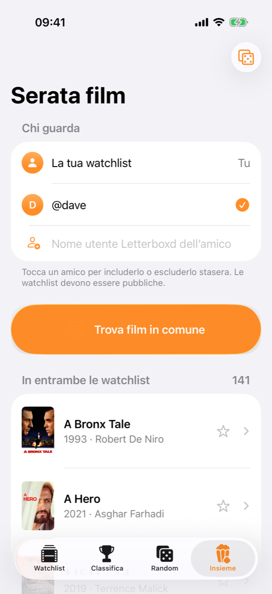

# Smarterboxd

Un'app iOS per la tua watchlist di [Letterboxd](https://letterboxd.com): scrivi il tuo nome utente e puoi sfogliarla, metterla in ordine, creare le tue classifiche dei film da vedere, scoprire quali film hai in comune con gli amici e lasciare al caso la scelta di stasera.

<p align="center">
  
  
  
  
</p>
<p align="center">
  
  
  
</p>

## Cosa fa

- **Watchlist dal nome utente.** Scrivi il tuo nome utente Letterboxd (oppure `@nome` o il link al profilo) e l'app scarica tutta la watchlist. Si aggiorna da sola quando la riapri, oppure trascinando la lista verso il basso.
- **Griglia o lista**, con cinque ordinamenti: aggiunti di recente o per primi, anno di uscita (dal più recente o dal meno recente), titolo.
- **Più classifiche.** Crea tutte le liste che vuoi (per esempio «Con gli amici» o «Serata di coppia»), segna i film con la stella e riordinali trascinandoli.
- **Insieme.** Aggiungi il nome utente di uno o più amici e scopri quali film avete in comune nelle watchlist: ideale per organizzare una serata film. Gli amici restano salvati e ogni volta scegli chi c'è. Con tre o più persone mostra anche i film che ha quasi tutto il gruppo. Il dado in alto estrae a sorte uno dei film in comune, con la stessa animazione di Random.
- **Random.** Non sai cosa guardare? L'app fa scorrere i titoli ed estrae un film da tutta la watchlist o da una delle tue liste.
- **Dettagli del film**: locandina, immagine di sfondo, regista, durata, generi, voto e trama nella lingua dell'app (in inglese se manca la traduzione).
- **Ricerca** per titolo o anno, dalla lente in alto nella Watchlist.
- **Nascondi** i film che non ti interessano più; puoi ripristinarli dalle impostazioni.
- **Importazione CSV** come alternativa al nome utente.

L'app è in **inglese e italiano** e segue la lingua del sistema. Lo stile è quello nativo di iOS 26, con l'effetto vetro (Liquid Glass) su tab bar, barre e pulsanti, e supporta la modalità scura. La tab bar si rimpicciolisce mentre scorri verso il basso e si riapre appena torni a scorrere verso l'alto.

## Come legge la watchlist

Letterboxd ha un'API, ma non è pubblica: l'accesso va richiesto e viene concesso di rado. Smarterboxd legge quindi la pagina pubblica della watchlist (`letterboxd.com/<utente>/watchlist/`), la stessa che vedi dal browser. Ne derivano due limiti:

- **La watchlist deve essere pubblica**, anche quella degli amici in «Insieme».
- **Se Letterboxd cambia la struttura delle sue pagine**, o blocca le richieste, il caricamento dal nome utente può smettere di funzionare finché l'app non viene aggiornata.

In questi casi puoi usare il file CSV: su Letterboxd vai in **Impostazioni › Dati › Esporta i tuoi dati**, estrai lo ZIP e importa `watchlist.csv` dall'app.

Classifiche e film nascosti vengono salvati sul telefono e restano anche se passi dal CSV al nome utente o viceversa.

## Requisiti

- Xcode 26 o successivo
- iOS 26 o successivo
- Una chiave API di [TMDb](https://www.themoviedb.org) (gratuita), per locandine e dettagli

## Installazione

1. Clona il repository:
   ```sh
   git clone https://github.com/dsaldamarco/Smarterboxd.git
   cd Smarterboxd
   ```
2. Crea il file con la tua chiave TMDb partendo dall'esempio:
   ```sh
   cp Secrets.example.xcconfig Secrets.xcconfig
   ```
   Apri `Secrets.xcconfig` e incolla la chiave al posto di `INCOLLA_QUI_LA_TUA_CHIAVE`. La trovi su TMDb in **Impostazioni › API**: è la "Chiave API" di 32 caratteri, non il token di accesso. Il file è escluso da git, quindi la chiave non finisce nel repository.
3. Apri `Smarterboxd.xcodeproj` in Xcode e avvia l'app.

Senza chiave l'app funziona lo stesso, ma senza locandine né dettagli dei film.

## Struttura del progetto

| File | Contenuto |
| --- | --- |
| `LetterboxdService.swift` | Scarica e interpreta le pagine della watchlist |
| `CSVParser.swift` | Legge il `watchlist.csv` esportato da Letterboxd |
| `TMDbService.swift` | Locandine e dettagli da TMDb, salvati sul telefono |
| `WatchlistStore.swift` | Stato dell'app: film, classifiche, film nascosti, account |
| `MovieNightView.swift` | «Insieme»: confronto tra le watchlist di più persone |
| `ShuffleView.swift` | Estrazione animata, usata da Random e da Insieme |
| `Localizable.xcstrings` | Testi dell'app in inglese e italiano |
| `*View.swift` | Le altre schermate in SwiftUI |

## Crediti

Questo prodotto usa l'API di TMDb ma non è approvato né certificato da TMDb.

Smarterboxd è un progetto indipendente e non è affiliato a Letterboxd.

## Licenza

Distribuito con licenza [MIT](LICENSE).
